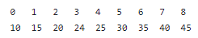

// Data: 22/10/2026
Tabela Hash e função de espelhamento

## Revisão
Antigamente guardavamos dados para fazer relatório, hoje é mais semantica(quais alunos vão cancelar a matriula em 2027) mais descoberta de conhecimento
pesquisa hoje: padrões em base de dados para relatório e tomada de decisão
- Revisão geral: Pesquisa
- Pesquisa:
Pesquisa da IA, como transformamos as palavras em números, e começamos a usar sinonimos pelas ocorrencias
hoje as llms são dependentes de processo de recuperação, vendo a probabilidade da proxima palavras
palavras para guardar: llms
transformes
enbeding = guarda os dados de forma vetorial
reg
    - o que é e para que serve?
    - localizar versus recuperar
    - complexidade das pesquisas: log n são complexidades binarias (como árvore)
    - sequencial,  O(n)
    - binária, O(log n)
    - digital, por dígitos, O(size)
    - hash O(1)
    - fluxo: armazenar, "ordenar" , pesquisar
    - saber os algoritmos
        - pesquisa binária
        - pesquisa digital
    - teoria de tabelas hash
        - tabela
        - função hash de endereçamento

# Exercício para ver
## Questões sobre Pesquisa

1) No universo de programação, baseada em Estruturas de Dados e Orientação a Objetos,
há classes ou estruturas para armazenar dados em memória. Cite e explique as 3 principais
estruturas em que programadores armazenam dados em memória e conseguem acessar dados de
maneira mais eficaz. 
Listas, árvores e tabela hash

2) Dentro dos métodos de pesquisa, há o sequencial e o binário. Entretanto, a pesquisa binária
mostra-se muito mais eficaz. Para usá-la, como a estrutura deve se apresentar e qual a filosofia
de trabalho da pesquisa binária. A Estrutura precisa estar ordenada, e a filosofia de trabalho é baseada em árvore binária de pesquisa

3) No universo de Tabelas Hash (técnica de espalhamento), os dados são armazenados e acessados
rapidamente, com uma complexidade O(1). Qual o recurso utilizado para que isso aconteça.Colocar as respostas em arquivo .txt e enviar para alexz@ufn.edu.br

Função Hash, ou função de calculo de endereço, sobre uma chave

4) Tendo como base o algoritmo de pesquisa binária, contabilize e mostra quantas comparações
ocorrem na estrutura até o número 24 ser localizado na lista.

coisas fundamentais,
saber um código de pesquisa binária
e um de método de ordenação(pente)